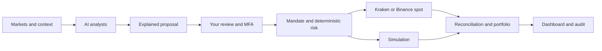

<a id="top"></a>

<div align="center">

<p>
  <a href="README.md"></a>
  <a href="README.en.md"></a>
</p>

<h1>🤖 WallyBot</h1>

<h3>Your self-hosted hub for AI-assisted analysis, portfolio tracking and trading</h3>

<p><b>Market data · Explained proposals · Your approval · Risk controls</b></p>

<p>
  <a href="https://github.com/robgallardof/wallybot/actions/workflows/ci.yml"></a>
  <a href="https://github.com/robgallardof/wallybot/commits/main"></a>
  
  
  <a href="https://github.com/robgallardof/wallybot/stargazers"></a>
</p>

<p>
  
  
  
  
  
  
  
  
  
  
  
</p>

<p>
  <a href="#-quick-start"><b>Quick start</b></a> ·
  <a href="#-set-up-your-real-account"><b>Real trading</b></a> ·
  <a href="#-how-it-works"><b>Architecture</b></a> ·
  <a href="#-documentation"><b>Documentation</b></a>
</p>

</div>

---

WallyBot brings together markets, AI-assisted analysis, portfolio tracking and controlled execution in one application that you host yourself. Analysts prepare **BUY, HOLD, SELL or REDUCE** proposals with an explanation and an expiry. **You decide what to approve**; deterministic controls re-check every trade before it is sent to the exchange.

> [!IMPORTANT]
> **Real trading is available on Kraken spot (USD, BTC/XBT, ETH) or Binance spot (USDT, BTC, ETH).** Every trade requires administrator approval with MFA. The AI never executes orders, and there are no withdrawals, transfers or leverage.

> [!NOTE]
> The application UI is available in Spanish and English. Some in-app labels referenced below are shown with their Spanish name in parentheses.

## ✨ What you can do

<table>
  <tr>
    <td width="50%" valign="top">
      <h4>📈 Markets</h4>
      Public Binance quotes with source, age and spread validation.
    </td>
    <td width="50%" valign="top">
      <h4>🧠 AI analysts</h4>
      Local Codex and Claude, configurable consensus and per-analyst availability.
    </td>
  </tr>
  <tr>
    <td valign="top">
      <h4>📝 Proposals</h4>
      Reasoning, risks, expiry, MFA approval, rejection and simulation.
    </td>
    <td valign="top">
      <h4>💼 Real account</h4>
      Encrypted credentials, verified balances and Kraken or Binance spot IOC orders.
    </td>
  </tr>
  <tr>
    <td valign="top">
      <h4>🛡️ Risk</h4>
      Per-trade, exposure and daily-loss limits; reconciliation and blocking on mismatches.
    </td>
    <td valign="top">
      <h4>📊 Portfolio</h4>
      Real tracking, FIFO accounting and simulated trade results.
    </td>
  </tr>
  <tr>
    <td valign="top">
      <h4>💬 Telegram</h4>
      Owner-scoped digests and review links; they never execute anything.
    </td>
    <td valign="top">
      <h4>🔬 Research</h4>
      Backtests and research jobs isolated from execution.
    </td>
  </tr>
  <tr>
    <td valign="top">
      <h4>⚙️ Operations</h4>
      Audit trail, service heartbeats, encrypted backups and verified recovery.
    </td>
    <td valign="top">
      <h4>🌐 Interface</h4>
      Spanish and English, light/dark themes and a mobile-friendly layout.
    </td>
  </tr>
</table>

## 🚀 Quick start

You need **Docker with Compose** and **Python 3.12+**. For development and local analysts: **uv**, **Node.js 22+**, **pnpm 10.11** and whichever AI CLIs you want to use.

```sh
git clone https://github.com/robgallardof/wallybot.git
cd wallybot
python scripts/bootstrap.py
docker compose up -d --build
```

1. Open **[localhost:3333/setup](http://localhost:3333/setup)**.
2. Read the generated token from `.secrets/bootstrap_token` directly on your machine.
3. Create your administrator, link your authenticator app and save the recovery codes.
4. Sign in and configure your connections and preferences.

There is no default account. The bootstrapper keeps existing secrets and configuration, and the system starts in **OBSERVE** until you enable features from the interface.

<details>
<summary><b>🪟 Windows: services + native analyst</b></summary>

<br>

After installing the dependencies and local CLIs:

```powershell
./scripts/start_wallybot.ps1
```

This starts the Docker services and the native analyst. See the [local analyst guide](docs/runbooks/native-ai-worker.md). The standard install listens on `127.0.0.1:3333`; for remote access follow the [HTTPS deployment guide](DEPLOYMENT.md).

</details>

## 🔑 Set up your real account

| Step | Where | What to do |
| :---: | --- | --- |
| **1** | Kraken or Binance | Create an API key **dedicated to WallyBot**. **Kraken:** query funds, query open/closed orders, create/modify and cancel/close orders; no deposit, withdrawal, transfer or earn. **Binance:** "System generated", only *Enable Reading* and *Enable Spot & Margin Trading*, restricted to your PC's public IP; no withdrawals, transfers, margin or futures, and no BNB fee payment. |
| **2** | **Connections** (Conexiones) | Choose BINANCE, tick real spot trading, and paste the key and private key. If anything fails, the message explains what to fix. Linking never sends an order. |
| **3** | **Settings → AI analysis** (Configuración → Análisis de IA) | Check that Codex and Claude show as available. |
| **4** | **Settings → Real-money trading** (Operaciones con dinero real) | Set the per-trade maximum, total exposure and daily loss (USDT on Binance) plus the price change limit (0.01–2%). Type `LIVE` and confirm with MFA. |
| **5** | **Portfolio** (Portafolio) | Review the real Binance account: verified balances, orders and filled quantities. Binance amounts are in USDT. |
| **6** | **Intelligence → Proposals** (Inteligencia → Propuestas) | Review each proposal, confirm "real money" and approve. Every approval is individual and single-use. |

> [!TIP]
> If an analyst shows as **unavailable**, run `claude auth login` or `codex login` in a terminal on this PC. WallyBot never disables an analyst or the agreement requirement on its own: if you prefer to use only one, clear it yourself together with "Require agreement".

> [!CAUTION]
> Keys are entered into your own installation and stored encrypted. **Never share API keys or seed phrases in chat or in the repository.**

More detail in the [complete real-trading guide](docs/runbooks/real-spot-trading.md): permissions, common errors, recovery and blocking causes.

## 🧭 How it works



**The AI proposes; authenticated approval and risk controls authorize.** Research processes and analysts have no access to trading credentials. Telegram leads to the web review: a link or command never sends a trade.

| Layer | Technology | Location |
| --- | --- | --- |
| 🖥️ Interface | Next.js, React, TypeScript | `apps/web` |
| 🔌 API | FastAPI, Pydantic | `apps/api` |
| ⏱️ Processes | Worker, scheduler, research | `apps/` |
| 🧠 Local analysts | Codex / Claude CLI | `apps/ai_worker` |
| 🧩 Core | Domain, application, infrastructure | `wallybot/` |
| 🗄️ Persistence | PostgreSQL, async SQLAlchemy, Alembic | `migrations/` |
| 🔁 Coordination | Redis; persistent locks and nonces | — |

## 📌 Current scope

- Real execution supports **Kraken spot USD/BTC/ETH** and **Binance spot USDT/BTC/ETH** with IOC limit orders and per-trade approval. The analyst studies the market of your real account's exchange.
- Stops and targets are **review notices**; they do not create automatic protective orders.
- External account changes that do not match the ledger **block** execution until reviewed. The historical cost of imported holdings is never invented.
- Local tests do not replace validation with a funded account and do not demonstrate profitability.

Constraints and roadmap: [RISK.md](RISK.md), [product mandate](docs/PRODUCT-MANDATE.md) and [pending work](docs/PENDING.md).

## 🛠️ Development and verification

<details>
<summary><b>Hybrid development environment</b></summary>

<br>

```sh
uv sync --frozen
pnpm --dir apps/web install --frozen-lockfile
uv run python scripts/dev.py
```

Stop the full Docker application first to avoid port conflicts. Hybrid mode keeps infrastructure in Docker and runs the application processes on your machine.

</details>

<details>
<summary><b>Tests, types and lint</b></summary>

<br>

```sh
uv run pytest tests/unit tests/property tests/contract tests/integration
uv run ruff check apps wallybot migrations scripts tests
uv run pyright wallybot apps/api apps/worker apps/scheduler apps/research_worker apps/ai_worker
pnpm --dir apps/web exec playwright install chromium
WALLY_E2E_PRODUCTION=1 pnpm --dir apps/web test:e2e
```

Integration tests require Docker. On Windows, if the client cannot find Docker Desktop, set `DOCKER_HOST=npipe:////./pipe/dockerDesktopLinuxEngine` in the test terminal.

</details>

> [!NOTE]
> **Local verification on October 12, 2026:** 971 backend tests (real, disposable PostgreSQL/Redis) and 19 production-mode browser tests passed; type checking reports no errors. Exchange tests use controlled responses. See [the evidence and its limits](docs/stats/testing.md).

## 💾 Backups

```sh
uv run python scripts/backup.py create
uv run python scripts/backup.py verify
```

Backups are encrypted into `backups/` (excluded from the repository), and `verify` restores them into an isolated PostgreSQL. Keep the backup key off this machine and follow the [recovery guide](docs/runbooks/recovery.md).

## 📚 Documentation

| Guide | Contents |
| --- | --- |
| 💱 [Real trading](docs/runbooks/real-spot-trading.md) | Kraken, Binance, limits, approval, errors and reconciliation |
| 🧠 [Local analysts](docs/runbooks/native-ai-worker.md) | CLIs, availability, startup and diagnostics (Spanish) |
| 🎯 [Product mandate](docs/PRODUCT-MANDATE.md) | Goals, allocation and operator decisions |
| 🏗️ [Architecture](ARCHITECTURE.md) | Process boundaries and contracts |
| 🔐 [Security](SECURITY.md) | Authentication, permissions and secret isolation |
| 🛡️ [Risk](RISK.md) | Capital and execution controls |
| 🗃️ [Data](DATA.md) | Accounting, consistency and quality |
| 🚢 [Deployment](DEPLOYMENT.md) | Installation, operations and remote access |
| ✅ [Testing](TESTING.md) | Invariants and acceptance criteria |
| 🧾 [Decisions](docs/adr/README.md) | Rationale and scope of technical decisions |
| 🗺️ [Diagrams](docs/diagrams/README.md) | Data, order and recovery flows |

---

<div align="center">

<b>Analysis with context. Decisions under your control.</b>

<sub>Built to self-host · No withdrawals · No direct AI orders</sub>

<br><br>

<a href="#top">⬆️ Back to top</a>

</div>
