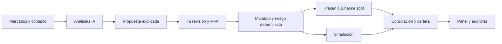
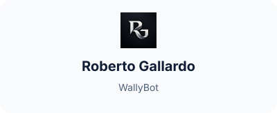

<a id="top"></a>

<div align="center">

<p>
  <a href="README.md"></a>
  <a href="README.en.md"></a>
</p>

<h1> WallyBot</h1>

<h3>Tu centro autoalojado de análisis, cartera y trading con IA</h3>

<p><b>Datos de mercado · Propuestas explicadas · Tu aprobación · Controles de riesgo</b></p>

<p>
  <a href="https://github.com/robgallardof/wallybot/actions/workflows/ci.yml"></a>
  <a href="https://github.com/robgallardof/wallybot/commits/main"></a>
  
  
  <a href="https://github.com/robgallardof/wallybot/stargazers"></a>
</p>

<p>
  
  
  
  
  
  
  
  
  
  
  
</p>

<p>
  <a href="#-inicio-rápido"><b>Inicio rápido</b></a> ·
  <a href="#-configura-tu-cuenta-real"><b>Trading real</b></a> ·
  <a href="#-cómo-funciona"><b>Arquitectura</b></a> ·
  <a href="#-documentación"><b>Documentación</b></a>
</p>

</div>

---

WallyBot reúne mercados, análisis asistido por IA, seguimiento de cartera y ejecución controlada en una aplicación que alojas tú. Los analistas preparan propuestas **BUY, HOLD, SELL o REDUCE** con explicación y vencimiento. **Tú decides qué aprobar**; los controles deterministas vuelven a comprobar cada operación antes de enviarla al exchange.

> [!IMPORTANT]
> **Trading real disponible: Kraken spot (USD, BTC/XBT, ETH) o Binance spot (USDT, BTC, ETH).** Cada operación requiere la aprobación del administrador con MFA. La IA nunca ejecuta órdenes, y no existen retiros, transferencias ni apalancamiento.

<a id="-configura-tu-cuenta-real"></a>

##  Configura tu cuenta real

| Paso | Dónde | Qué hacer |
| :---: | --- | --- |
| **1** | Kraken o Binance | Crea una clave API **exclusiva para WallyBot**. **Kraken:** consultar fondos, órdenes abiertas/cerradas, crear/modificar y cancelar/cerrar órdenes; sin depósitos, retiros, transferencias ni earn. **Binance:** «System generated», solo *Enable Reading* y *Enable Spot & Margin Trading*, restringida a la IP pública de tu PC; sin retiros, transferencias, margen ni futuros, y sin pagar comisiones con BNB. |
| **2** | **Conexiones** | Elige BINANCE, marca trading spot real, y pega la clave y la clave privada. Si algo falla, el mensaje explica qué corregir. Vincular no envía órdenes. |
| **3** | **Configuración → Análisis de IA** | Comprueba que Codex y Claude aparezcan como «Disponible». |
| **4** | **Configuración → Operaciones con dinero real** | Indica máximo por operación, exposición total y pérdida diaria (USDT en Binance) y la variación de precio (0,01–2 %). Escribe `LIVE` y confirma con MFA. |
| **5** | **Portafolio** | Revisa la «Cuenta real Binance»: saldos verificados, órdenes y cantidades ejecutadas. En Binance los importes van en USDT. |
| **6** | **Inteligencia → Propuestas** | Revisa cada propuesta, confirma «dinero real» y aprueba. Cada aprobación es individual y de un solo uso. |

> [!TIP]
> Si un analista aparece como **No disponible**, ejecuta `claude auth login` o `codex login` en una terminal de esta PC. WallyBot nunca desactiva un analista ni la exigencia de coincidencia por su cuenta: si prefieres usar solo uno, desmárcalo tú junto con «Exigir coincidencia».

> [!CAUTION]
> Las claves se introducen en tu instalación y se guardan cifradas. **Nunca compartas claves API ni frases semilla por chat ni en el repositorio.**

Más detalle en la [guía completa de trading real](docs/runbooks/real-spot-trading.md): permisos, errores frecuentes, recuperación y causas de bloqueo.

<a id="-qué-puedes-hacer"></a>

##  Qué puedes hacer

<table>
  <tr>
    <td width="50%" valign="top">
      <h4> Mercados</h4>
      Cotizaciones públicas de Binance con validación de origen, antigüedad y diferencial.
    </td>
    <td width="50%" valign="top">
      <h4> Analistas IA</h4>
      Codex y Claude locales, consenso configurable y disponibilidad visible por analista.
    </td>
  </tr>
  <tr>
    <td valign="top">
      <h4> Propuestas</h4>
      Explicación, riesgos, vencimiento, aprobación con MFA, rechazo y simulación.
    </td>
    <td valign="top">
      <h4> Cuenta real</h4>
      Credenciales cifradas, saldos verificados y órdenes spot IOC en Kraken o Binance.
    </td>
  </tr>
  <tr>
    <td valign="top">
      <h4> Riesgo</h4>
      Límites por operación, exposición y pérdida diaria; conciliación y bloqueo ante discrepancias.
    </td>
    <td valign="top">
      <h4> Cartera</h4>
      Seguimiento real, contabilidad FIFO y resultados de operaciones simuladas.
    </td>
  </tr>
  <tr>
    <td valign="top">
      <h4> Telegram</h4>
      Resúmenes y enlaces de revisión vinculados al propietario; nunca ejecutan nada.
    </td>
    <td valign="top">
      <h4> Investigación</h4>
      Backtests y procesos de investigación aislados de la ejecución.
    </td>
  </tr>
  <tr>
    <td valign="top">
      <h4> Operación</h4>
      Auditoría, heartbeats de servicios, copias cifradas y recuperación verificada.
    </td>
    <td valign="top">
      <h4> Interfaz</h4>
      Español e inglés, tema claro/oscuro y diseño adaptable a móvil.
    </td>
  </tr>
</table>

<a id="-inicio-rápido"></a>

##  Inicio rápido

Necesitas **Docker con Compose** y **Python 3.12+**. Para desarrollo y analistas locales: **uv**, **Node.js 22+**, **pnpm 10.11** y las CLI de IA que quieras usar.

```sh
git clone https://github.com/robgallardof/wallybot.git
cd wallybot
python scripts/bootstrap.py
docker compose up -d --build
```

1. Abre **[localhost:3333/setup](http://localhost:3333/setup)**.
2. Consulta el token generado en `.secrets/bootstrap_token` directamente en tu equipo.
3. Crea tu administrador, vincula tu autenticador y guarda los códigos de recuperación.
4. Entra al panel y configura tus conexiones y preferencias.

No hay cuenta predeterminada. El inicializador conserva los secretos y la configuración existentes, y el sistema arranca en **OBSERVE** hasta que actives funciones desde la interfaz.

<details>
<summary><b> Windows: servicios + analista nativo</b></summary>

<br>

Después de preparar las dependencias y las CLI locales:

```powershell
./scripts/start_wallybot.ps1
```

Inicia los servicios Docker y el analista nativo. Consulta la [guía del analista local](docs/runbooks/native-ai-worker.md). La instalación estándar escucha en `127.0.0.1:3333`; para acceso remoto usa la [guía de despliegue con HTTPS](DEPLOYMENT.md).

</details>

<a id="-alcance-actual"></a>

##  Alcance actual

- La ejecución real admite **Kraken spot USD/BTC/ETH** y **Binance spot USDT/BTC/ETH** con órdenes límite IOC y aprobación por operación. El analista estudia el mercado del exchange de tu cuenta real.
- Stops y objetivos son **avisos de revisión**; no generan órdenes protectoras automáticas.
- Cambios externos en la cuenta que no cuadren con la contabilidad **bloquean** la ejecución hasta revisarlos. El coste histórico de posiciones importadas no se inventa.
- Las pruebas locales no sustituyen una validación con una cuenta financiada ni demuestran rentabilidad.

Restricciones y evolución prevista: [RISK.md](RISK.md), [mandato del producto](docs/PRODUCT-MANDATE.md) y [trabajo pendiente](docs/PENDING.md).

<a id="-cómo-funciona"></a>

##  Cómo funciona

<details>
<summary>Diagrama técnico</summary>



</details>

**La IA propone; la aprobación autenticada y los controles de riesgo autorizan.** Los procesos de investigación y los analistas no tienen acceso a las credenciales de trading. Telegram lleva a la revisión web: un enlace o comando nunca envía una operación.

| Capa | Tecnología | Ubicación |
| --- | --- | --- |
|  Interfaz | Next.js, React, TypeScript | `apps/web` |
|  API | FastAPI, Pydantic | `apps/api` |
| ⏱️ Procesos | Worker, scheduler, investigación | `apps/` |
|  Analistas locales | CLI de Codex / Claude | `apps/ai_worker` |
|  Núcleo | Dominio, aplicación, infraestructura | `wallybot/` |
|  Persistencia | PostgreSQL, SQLAlchemy async, Alembic | `migrations/` |
|  Coordinación | Redis; bloqueos y nonces persistentes | — |

<a id="-copias-de-seguridad"></a>

##  Copias de seguridad

```sh
uv run python scripts/backup.py create
uv run python scripts/backup.py verify
```

Las copias se cifran en `backups/` (excluido del repositorio) y `verify` las restaura en un PostgreSQL aislado. Guarda la clave de respaldo fuera del equipo y sigue la [guía de recuperación](docs/runbooks/recovery.md).

<a id="️-desarrollo-y-verificación"></a>

##  Desarrollo y verificación

<details>
<summary><b>Entorno híbrido de desarrollo</b></summary>

<br>

```sh
uv sync --frozen
pnpm --dir apps/web install --frozen-lockfile
uv run python scripts/dev.py
```

Detén antes la aplicación Docker completa para evitar conflictos de puerto. El modo híbrido mantiene la infraestructura en Docker y ejecuta los procesos de aplicación en el equipo.

</details>

<details>
<summary><b>Pruebas, tipos y lint</b></summary>

<br>

```sh
uv run pytest tests/unit tests/property tests/contract tests/integration
uv run ruff check apps wallybot migrations scripts tests
uv run pyright wallybot apps/api apps/worker apps/scheduler apps/research_worker apps/ai_worker
pnpm --dir apps/web exec playwright install chromium
WALLY_E2E_PRODUCTION=1 pnpm --dir apps/web test:e2e
```

Las pruebas de integración requieren Docker. En Windows, si el cliente no detecta Docker Desktop, configura `DOCKER_HOST=npipe:////./pipe/dockerDesktopLinuxEngine` en la terminal de pruebas.

</details>

> [!NOTE]
> **Verificación local del 12 de octubre de 2026:** 971 pruebas de backend (PostgreSQL/Redis reales y desechables) y 19 pruebas de navegador en modo producción aprobadas; comprobación de tipos sin errores. Las pruebas del exchange usan respuestas controladas. Consulta [la evidencia y sus límites](docs/stats/testing.md).

<a id="-documentación"></a>

##  Documentación

| Guía | Contenido |
| --- | --- |
|  [Trading real](docs/runbooks/real-spot-trading.md) | Kraken, Binance, límites, aprobación, errores y conciliación |
|  [Analistas locales](docs/runbooks/native-ai-worker.md) | CLI, disponibilidad, arranque y diagnóstico |
|  [Mandato del producto](docs/PRODUCT-MANDATE.md) | Objetivos, asignación y decisiones del operador |
|  [Arquitectura](ARCHITECTURE.md) | Límites entre procesos y contratos |
|  [Seguridad](SECURITY.md) | Autenticación, permisos y aislamiento de secretos |
|  [Riesgo](RISK.md) | Controles de capital y ejecución |
|  [Datos](DATA.md) | Contabilidad, consistencia y calidad |
|  [Despliegue](DEPLOYMENT.md) | Instalación, operación y acceso remoto |
|  [Pruebas](TESTING.md) | Invariantes y criterios de aceptación |
|  [Decisiones](docs/adr/README.md) | Motivos y alcance de las decisiones técnicas |
|  [Diagramas](docs/diagrams/README.md) | Flujos de datos, órdenes y recuperación |

---

<div align="center">

<b>Análisis con contexto. Decisiones bajo tu control.</b>

<sub>Hecho para autoalojarse · Sin retiros · Sin órdenes directas de la IA</sub>

<br><br>

<a href="#top">⬆️ Volver arriba</a>

</div>

<p align="center"><a href="#top">Volver al inicio</a></p>

<!-- readme-builder:signature:start -->
<p align="center"><a href="https://github.com/robgallardof"><picture><source media="(prefers-color-scheme: dark)" srcset="assets/readme/brand/signature-es-dark.svg" /></picture></a></p>
<!-- readme-builder:signature:end -->
