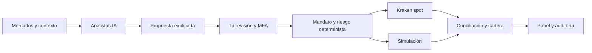

<div align="center">

# WallyBot
### Tu centro de análisis, cartera y trading con IA

**Datos de mercado · Propuestas explicadas · Tu aprobación · Controles de riesgo**


[Inicio rápido](#inicio-rápido) · [Trading real](#configura-tu-cuenta-real) · [Arquitectura](#cómo-funciona) · [Documentación](#documentación)

</div>

---

WallyBot reúne mercados, análisis asistido por IA, seguimiento de cartera y ejecución controlada en una aplicación que alojas tú. Los analistas preparan propuestas BUY, HOLD, SELL o REDUCE con explicación y vencimiento. Tú decides qué aprobar; los controles deterministas vuelven a comprobar cada operación antes de enviarla al exchange.

**Trading real disponible: Kraken spot, con USD, BTC/XBT y ETH.** Cada operación requiere aprobación del administrador. La simulación también está disponible para investigar estrategias.

## Qué puedes hacer

| Función | Disponible |
| --- | --- |
| Mercados | Cotizaciones públicas de Kraken con validación de origen y antigüedad |
| Analistas IA | Codex y Claude locales, configuración y consenso de proveedores |
| Propuestas | Explicación, revisión, aprobación con MFA, rechazo y simulación |
| Cuenta real | Credenciales cifradas, saldos observados y órdenes spot en Kraken |
| Riesgo | Límites por operación, exposición y pérdida; conciliación y bloqueo ante discrepancias |
| Cartera | Seguimiento real; contabilidad FIFO y resultados de operaciones simuladas |
| Telegram | Resúmenes y enlaces de revisión vinculados al propietario |
| Investigación | Backtests y procesos de investigación separados de la ejecución |
| Operación | Auditoría, estado de servicios, copias cifradas y recuperación |
| Interfaz | Español e inglés, temas claro/oscuro y diseño adaptable |

## Inicio rápido

Necesitas **Docker con Compose y Python 3.12+**. Para desarrollo y analistas locales: **uv, Node.js 22+ y pnpm 10.11**, además de las CLI de IA que quieras utilizar.

```sh
git clone https://github.com/robgallardof/wallybot.git
cd wallybot
python scripts/bootstrap.py
docker compose up -d --build
```

1. Abre **[localhost:3333/setup](http://localhost:3333/setup)**.
2. Consulta el token generado en `.secrets/bootstrap_token` directamente en tu equipo.
3. Crea tu administrador, vincula tu autenticador y guarda los códigos de recuperación.
4. Entra al panel y configura tus conexiones y preferencias.

No hay una cuenta predeterminada. El inicializador conserva los secretos y la configuración existentes. El arranque mantiene el sistema en observación hasta que actives las funciones desde la interfaz.

En Windows, después de preparar las dependencias y las CLI locales:

```powershell
./scripts/start_wallybot.ps1
```

Este acceso inicia los servicios y el analista nativo. Consulta la [guía del analista local](docs/runbooks/native-ai-worker.md) para su preparación y diagnóstico. La instalación estándar escucha en `127.0.0.1:3333`; para acceso remoto usa la [guía de despliegue con HTTPS](DEPLOYMENT.md).

## Configura tu cuenta real

1. En **Conexiones**, añade una clave API de Kraken con permisos para consultar fondos/órdenes y crear/cancelar operaciones. Debe carecer de permisos de retiro, transferencias y gestión de fondos.
2. En **Ajustes → Trading real**, selecciona la conexión e introduce tus límites en USD: importe por operación, exposición total y pérdida diaria máxima. Configura también la variación de precio permitida.
3. Confirma la activación escribiendo `LIVE` y completando MFA. WallyBot verifica permisos y concilia el saldo antes de habilitarla.
4. Activa los analistas que tengas preparados. Revisa cada propuesta y confirma individualmente las operaciones reales.
5. Consulta los saldos, órdenes y cantidades ejecutadas en **Cartera**. Puedes pausar la ejecución desde el panel.

Las claves se introducen en tu instalación y se almacenan cifradas. **Nunca compartas claves API ni frases semilla por chat o en el repositorio.**

Consulta la [guía completa de trading real](docs/runbooks/real-spot-trading.md) para permisos, restricciones, recuperación y causas de bloqueo.

## Cómo funciona



La IA propone; la aprobación autenticada y los controles de riesgo autorizan la ejecución. Los procesos de investigación y los analistas carecen de acceso a las credenciales de trading. Telegram conduce a la revisión web: un enlace o comando no envía una operación.

| Capa | Tecnología / ubicación |
| --- | --- |
| Interfaz | Next.js, React y TypeScript — `apps/web` |
| API | FastAPI y Pydantic — `apps/api` |
| Procesos | Worker, scheduler e investigación — `apps/` |
| Analistas locales | CLI de Codex/Claude — `apps/ai_worker` |
| Núcleo compartido | Dominio, aplicación e infraestructura — `wallybot/` |
| Persistencia | PostgreSQL, SQLAlchemy async y Alembic |
| Coordinación | Redis; bloqueos y nonces persistentes para el exchange |

## Alcance actual

- La ejecución real admite **Kraken spot USD/BTC/ETH**, con órdenes limitadas IOC y aprobación por operación. Otros proveedores no constituyen adaptadores de ejecución real.
- Los niveles de stop y objetivo son información para revisión; no generan órdenes protectoras automáticas.
- Cambios externos en la cuenta que no coincidan con la contabilidad bloquean la ejecución hasta su revisión. El coste histórico de posiciones importadas no se inventa.
- La ejecución real requiere que configures tu cuenta y tus límites. Las pruebas locales no sustituyen una validación con una cuenta financiada ni demuestran rentabilidad.

Las restricciones y la evolución prevista están en [RISK.md](RISK.md), el [mandato del producto](docs/PRODUCT-MANDATE.md) y el [trabajo pendiente](docs/PENDING.md).

## Desarrollo y verificación

```sh
uv sync --frozen
pnpm --dir apps/web install --frozen-lockfile
uv run python scripts/dev.py
```

Detén antes la aplicación Docker completa para evitar conflictos de puerto. El modo híbrido mantiene la infraestructura en Docker y ejecuta los procesos de aplicación en el equipo.

```sh
uv run pytest tests/unit tests/property tests/contract tests/integration
uv run ruff check apps wallybot migrations scripts tests
uv run pyright wallybot apps/api apps/worker apps/scheduler apps/research_worker apps/ai_worker
pnpm --dir apps/web exec playwright install chromium
pnpm --dir apps/web test:e2e
```

**Verificación local registrada el 12 de octubre de 2026:** 952 pruebas de backend y 19 pruebas de navegador de producción aprobadas; comprobación de tipos de WallyBot sin errores. Las pruebas del exchange usan respuestas controladas y las de integración utilizan PostgreSQL/Redis desechables. Consulta [la evidencia y sus límites](docs/stats/testing.md).

Las pruebas de integración requieren Docker. En Windows, si el cliente no detecta Docker Desktop, configura `DOCKER_HOST=npipe:////./pipe/dockerDesktopLinuxEngine` en la terminal de pruebas.

## Copias de seguridad

```sh
uv run python scripts/backup.py create
uv run python scripts/backup.py verify
```

Las copias se cifran y guardan en `backups/`, excluido del repositorio. Conserva la clave de respaldo fuera del equipo y sigue la [guía de recuperación](docs/runbooks/recovery.md).

## Documentación

| Guía | Contenido |
| --- | --- |
| [Trading real](docs/runbooks/real-spot-trading.md) | Configuración de Kraken, límites, aprobación y conciliación |
| [Analistas locales](docs/runbooks/native-ai-worker.md) | Preparación de CLI, arranque y diagnóstico |
| [Mandato del producto](docs/PRODUCT-MANDATE.md) | Objetivos, asignación y decisiones del operador |
| [Arquitectura](ARCHITECTURE.md) | Límites entre procesos y contratos |
| [Seguridad](SECURITY.md) | Autenticación, permisos y aislamiento de secretos |
| [Riesgo](RISK.md) | Controles de capital y ejecución |
| [Datos](DATA.md) | Contabilidad, consistencia y calidad |
| [Despliegue](DEPLOYMENT.md) | Instalación, operación y acceso remoto |
| [Pruebas](TESTING.md) | Invariantes y criterios de aceptación |
| [Decisiones](docs/adr/README.md) | Motivos y alcance de las decisiones técnicas |
| [Diagramas](docs/diagrams/README.md) | Flujos de datos, órdenes y recuperación |

---

<div align="center">

**Análisis con contexto. Decisiones bajo tu control.**

</div>
