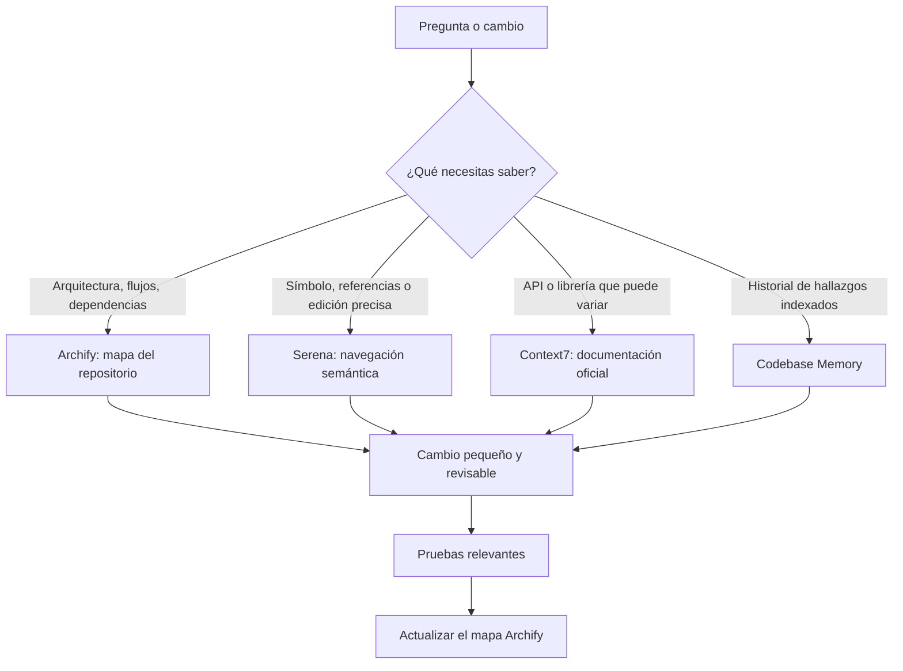

# Herramientas de desarrollo asistido

Esta guía documenta cómo se navega y mantiene WallyBot. Es documentación del proyecto: no
depende de enlaces a repositorios externos ni cambia el comportamiento de la aplicación.

## Qué herramienta usar

| Herramienta | Úsala para | No la uses para |
| --- | --- | --- |
| **Archify** | Comprender componentes, rutas, dependencias y flujos entre archivos. | Buscar un texto exacto o modificar un símbolo puntual. |
| **Serena** | Localizar una clase, función o tipo; ver referencias e implementar un cambio semántico pequeño. | Sustituir el mapa arquitectónico completo. |
| **Context7** | Confirmar comportamiento actual de FastAPI, SQLAlchemy, Pydantic, React, Vite, CCXT u otra dependencia. | Adivinar cómo está implementado WallyBot. |
| **Codebase Memory** | Recuperar hallazgos persistentes, decisiones o zonas ya indexadas. | Reemplazar el análisis del código actual. |
| **Búsqueda local** | Encontrar cadenas, archivos generados, configuración y registros concretos. | Inferir relaciones complejas entre componentes. |

## Archify: el mapa de WallyBot

El grafo de Archify contiene un mapa consultable, un informe y una vista visual. Es un artefacto
de navegación del repositorio, no una
fuente de verdad que reemplace los documentos de diseño.

Antes de una pregunta sobre arquitectura o flujo, consulta el grafo existente:

Antes de una pregunta sobre arquitectura o flujo, consulta el mapa con una búsqueda, un camino
entre dos componentes o una explicación puntual. Después de modificar código o documentación,
actualízalo de forma incremental. Si cambia documentación, diagramas o recursos que no sean
código, revisa el resultado para confirmar que el cambio se extrajo. No indexar nunca
`.env`, `.secrets/`, credenciales, claves privadas ni copias de seguridad.

Los diagramas que explican el producto pertenecen a WallyBot y se mantienen en
[`docs/diagrams/README.md`](diagrams/README.md). El grafo complementa esos diagramas: ayuda a
encontrar la implementación real que los sostiene.

## Serena: cambios precisos y seguros

Cuando la tarea nombra una clase, función, endpoint, tipo o componente, usa Serena para:

1. Encontrar el símbolo y sus referencias.
2. Identificar la implementación que realmente se ejecuta.
3. Modificar solo el alcance necesario.
4. Revisar los consumidores del símbolo antes de cerrar el cambio.

Esto reduce colisiones con otros agentes: no reformatees ni reescribas archivos completos cuando
el cambio puede limitarse al símbolo solicitado. Antes de tocar archivos compartidos, revisa el
estado de trabajo y conserva las modificaciones ajenas.

## Context7: dependencias sin adivinar

Consulta Context7 antes de tomar decisiones que dependan de versiones o contratos externos. Por
ejemplo: dependencias de FastAPI, sesiones async de SQLAlchemy, validación de Pydantic, contratos
de React Query, APIs de Vite o adaptadores de mercado.

La documentación externa confirma el contrato de una dependencia; la arquitectura y las reglas de
WallyBot se verifican primero en `ARCHITECTURE.md`, `SECURITY.md`, `RISK.md`, `DATA.md` y
`TESTING.md`.

## Rutina para un cambio

1. Lee `.ai/CURRENT.md` y `.ai/HANDOFF.md`, y revisa los cambios locales.
2. Para seguridad, riesgo, credenciales o ejecución, lee primero el documento rector
   correspondiente.
3. Usa Archify para preguntas de relación entre módulos; Serena para símbolos; Context7 para
   contratos externos.
4. Implementa un cambio acotado. No habilites retiros, transferencias ni ejecución directa por IA.
5. Ejecuta las pruebas de la capa modificada y revisa el diff.
6. Actualiza el mapa Archify y deja el handoff actualizado si la decisión es durable.

## Reglas que no se negocian

- No leer, imprimir ni indexar secretos.
- La IA puede analizar y proponer; no puede enviar órdenes directamente.
- Los datos de cada usuario se consultan con su ámbito de cuenta, nunca por un identificador
  elegido desde el cliente.
- Dinero con `Decimal`, fechas UTC con zona horaria e identificadores estables.
- Los diagramas deben distinguir el diseño objetivo de lo ya desplegado.
