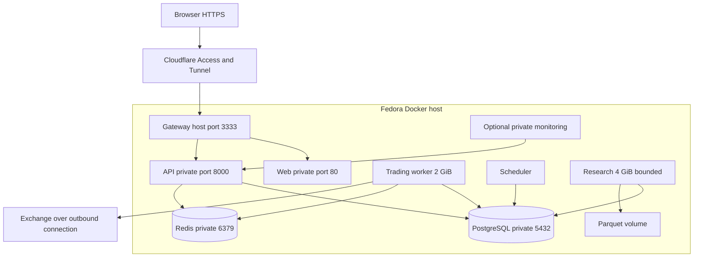

# Deployment

Research database access is restricted by grants; the edge does not expose PostgreSQL. Host cloudflared uses localhost:3333; container cloudflared uses gateway:3333. See DEPLOYMENT for origin filtering and hybrid-only loopback bindings.
