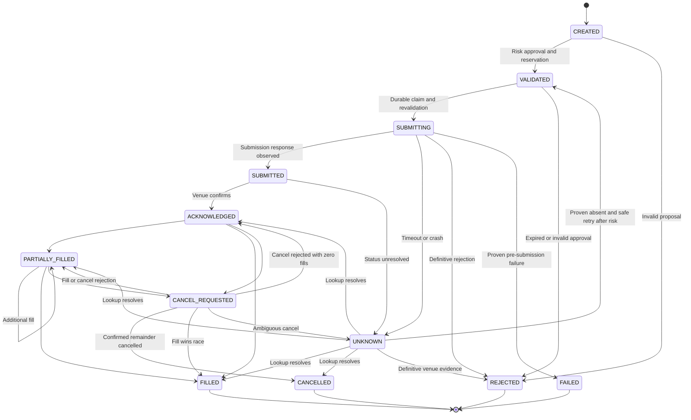

# Order lifecycle

The state machine records observations, not assumptions about network delivery. FAILED means a definitive failure; an ambiguous submission is UNKNOWN. Cancel intent may be pending while fills continue. Late fills after a cancellation observation are reconciled against authoritative cumulative quantity and retained in history.

